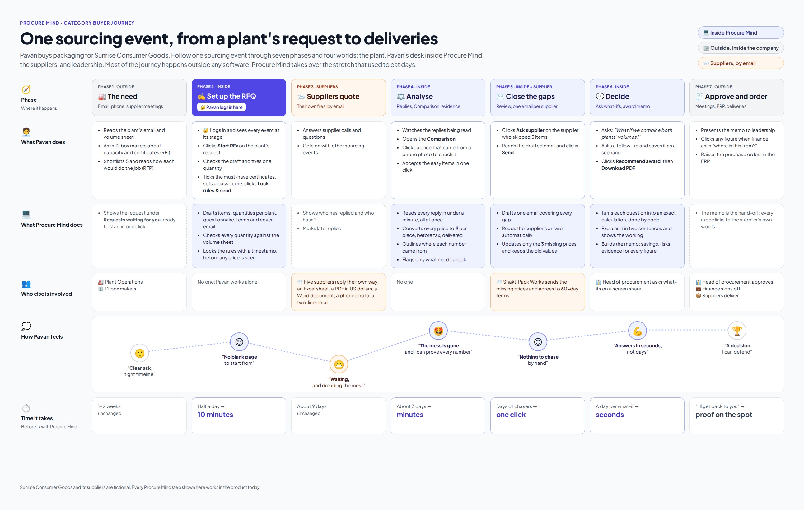

# Procure Mind

**A sourcing workspace for category buyers.** It drafts the request for quotation, reads whatever suppliers send back (spreadsheets, PDFs, Word files, phone photos, plain emails), puts every quote on one comparable basis, and takes the buyer from what-if questions to an award recommendation they can defend, without retyping a single number.


> **Status:** a working product running on fictional data. Every screen below is live: the AI really reads the files, and the numbers are really calculated. A public link to try it is coming shortly.

---

## The problem

A category buyer sends a clean quote template to five shortlisted suppliers. What comes back is anything but clean:

| Supplier sends | Hidden inside |
|---|---|
| An Excel sheet in their own layout | "Price per box" actually means per bundle of 100 boxes |
| A PDF on letterhead | Prices in US dollars, a discount buried in a footnote, tax included on some lines |
| A Word document | Prices written in paragraphs; three items quietly left out |
| A tilted phone photo of a rate card | Priced per kilogram, part of it unreadable from glare, an expired quality certificate |
| A two-line email | "Rest same as last year, freight extra" |

Today the buyer spends **about three days** retyping this into one spreadsheet. Then a senior leader asks *"What if we split the award between the cheapest suppliers who passed our quality checks?"*, and the spreadsheet has to be rebuilt. Nobody has chased the supplier who skipped three items. And when the finance team asks *"where does this number come from?"*, the answer is a hunt through email attachments.

## What Procure Mind does

| | Moment | What the buyer experiences |
|---|---|---|
| ✍️ | **Draft** | Procure Mind turns a plant's request into a complete request for quotation: items, quantities per plant, quality questionnaire, terms, cover email. The buyer fixes the scoring rules *before* any price is seen. |
| 📥 | **Receive** | Replies arrive in any format. The AI reads each one in under a minute, in parallel, with plain-language progress. |
| ⚖️ | **Compare** | Every price is converted to one basis (rupees per piece, before tax, delivered to the plant). Units, currencies, discounts, volume tiers and last year's contract prices are all handled. |
| 🔍 | **Prove** | Click any number and see the supplier's own words: the spreadsheet cell, the PDF line, or the exact spot on the photo. |
| ✉️ | **Chase** | Gaps become one polite, specific email per supplier. When the supplier replies, only the affected numbers update. |
| 💬 | **Decide** | Ask what-if questions in plain words. Save the answer as a scenario and turn it into an award memo with savings, risks and evidence. |

<table>
<tr>
<td width="50%"><br><sub>🔍 Every number links to its source, even on a tilted phone photo.</sub></td>
<td width="50%"><br><sub>💬 What-if questions answered in seconds, with the working shown.</sub></td>
</tr>
<tr>
<td width="50%"><br><sub>✉️ One targeted email per supplier, drafted for the buyer.</sub></td>
<td width="50%"><br><sub>🏆 An award memo where every rupee is clickable.</sub></td>
</tr>
</table>

## The buyer's journey

Most of a sourcing event happens outside any software: plant requests, supplier emails, approval meetings. The map shows the whole event and where Procure Mind takes over the stretch that used to eat days.



More in [User journeys](docs/02-user-journeys.md), including where the login fits.

## Three principles that make it trustworthy

1. **Every number has a receipt.** Nothing appears on screen without a link back to the supplier's own words.
2. **The AI reads and writes; plain code does the maths.** The AI never calculates a figure the buyer sees. Totals, savings and conversions are computed by ordinary, tested code, and any number the AI writes in a sentence is checked against that calculation.
3. **Doubt is flagged, never hidden.** A missing price, an unclear discount or an expired certificate is shown and explained, never quietly assumed.

## Proof that it works

| Measure | Result |
|---|---|
| Prices read correctly by the live AI across five messy replies | **129 of 129** |
| Prices converted to the common basis, against a hand-checked answer key | **300 of 300** |
| Time to read one reply | **under a minute**, all replies in parallel (vs about three days by hand) |
| A first-time user's full journey, from sign-up to award memo, run automatically in a real browser | **passes in about two minutes** |
| Planted traps (unit tricks, currency, hidden discount, missing items, glare, expired certificate, "same as last year") | **all caught and explained** |

## Read it in order

| # | Document | What you'll get from it | Time |
|---|---|---|---|
| 1 | [Product requirements](docs/01-product-requirements.md) | The problem, who it's for, what success means, what's in and out | 10 min |
| 2 | [User journeys](docs/02-user-journeys.md) | The buyer's day, inside and outside the product, step by step | 8 min |
| 3 | [How it is built](docs/03-how-it-is-built.md) | A plain-English summary first, then the technical design | 5–15 min |
| 4 | [Screens](docs/04-screen-designs.md) | Every screen, with the design choices behind it | 5 min |
| 5 | [Walkthrough](docs/05-walkthrough.md) | A guided ten-minute tour of the live product | 10 min |
| 6 | [Brand and design](docs/06-brand-and-design/) | Three brand directions explored on the same screens, the one chosen, and the rules for colour, type and voice | 5 min |
| 7 | [Glossary](docs/07-glossary.md) | Every procurement and technical term in plain English | as needed |

## What's in this repository

| Folder | What's inside | Do you need to open it? |
|---|---|---|
| [`docs/`](docs/) | All the documents above, plus screenshots, brand boards and diagrams | **Yes, start here** |
| [`src/`](src/) | The application itself: screens, AI instructions, calculation engine | Only to read the code |
| [`sample-data/`](sample-data/) | The fictional company, suppliers, quotes and files the product runs on | To see the "messy replies" for yourself |
| [`database/`](database/) | How the database is set up, including the rule that each user sees only their own data | Engineers only |
| [`tests/`](tests/) | The automated checks that prove it works | To see how quality is verified |
| [`tools/`](tools/) | The generator that creates the sample data and diagrams | Engineers only |
| [`scripts/`](scripts/) | One-command helpers: set up the database, run checks, take screenshots | Engineers only |
| `public/` and the files at the top level | Settings the build tools expect in this exact place | No |

`CLAUDE.md` and `AGENTS.md` are working notes for the AI assistant that helped build the product. They record decisions and project status.

## How it was made

Procure Mind was built the way a product team would build it: problem and requirements → user journeys → architecture → screen designs → build → test → brand and voice → ship. Each phase produced a document in [`docs/`](docs/), and each was reviewed before the next began. When the working product still felt generic, three brand directions were explored on the same screens before one was chosen ([Brand and design](docs/06-brand-and-design/)). The product manager set direction and made every product decision. The code was written with Claude Code, Anthropic's AI coding assistant, under that direction.

<details>
<summary><b>Run it yourself (for engineers)</b></summary>

Requirements: Node.js 24, a Supabase project (database, login and file storage) and an OpenAI API key.

```bash
cp .env.example .env.local      # fill in Supabase and OpenAI values
npm install
npm run db:migrate              # create tables and security rules
npm run dev                     # open http://localhost:3000 and create an account
```

Checks:

```bash
npm test                        # calculation engine + database security tests
npm run typecheck && npx eslint .
bash scripts/e2e.sh             # the full first-time user journey in a real browser
bash scripts/eval-all.sh        # live AI accuracy on the sample replies (small AI cost)
```

Built with Next.js 16 (TypeScript), Tailwind CSS, Supabase (Postgres with row-level security, Auth, Storage) and the OpenAI API (`gpt-5.5`).
</details>
