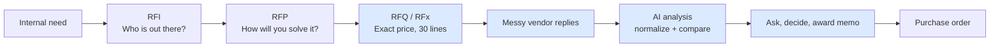

# 01 — Product Requirements (PRD): Procure Mind V2.0

**Status:** Draft v3, awaiting PM approval · **Date:** 2026-10-27 · **Owner:** PM (Pavan V) · **Demo:** 2026-10-28

> **Tagline:** Kill the quote spreadsheet. Procure Mind takes the buyer from an internal request, through an AI-drafted RFQ and a flood of messy vendor replies, to a defensible award, without retyping a single number.

---

## 0. Decisions (resolved)

| # | Question | Decision |
|---|---|---|
| D1 | Demo or real product? | **Demo / challenge submission**, built honestly enough to grow into a full product later |
| D2 | Category | **Corrugated packaging** |
| D3 | Reply channel | **Email**, with vendors replying in every format: Excel, PDF, Word, a vague angled phone photo, plain email text. For the demo, sending and receiving are **simulated inside the app** (a demo inbox), see risk R6 |
| D4 | Store last year's prices? | **Yes**: a mock contract database with last year's contracts |
| D5 | Deadline | **Demo on 2026-10-28. Build in one day.** This drives the MVP cut and build order in §6 |
| D6 | Hosting and access | **Hosted on the internet with user-account login.** A working prototype, ready for a live demo at a public web address |
| D7 | Documents | **All design documents are kept**: user journeys, architecture, wireframes (drawn with the Excalidraw extension in VS Code). The **detailed backlog is skipped** and listed as a roadmap item (§14) |

---

## 1. Where this product sits in the procurement lifecycle

Buying anything non-trivial follows a fixed corporate sequence. Procure Mind focuses on the **painful middle**: from the formal quote request to the award decision. It still knows about, and shows, the stages around it.

Blue = what Procure Mind does. The other stages show up as **context**: seeded data the product reads, not workflows it runs.

| Stage | What happens (our packaging story) | Procure Mind's role in the demo |
|---|---|---|
| **Internal need** | The Plant Operations team at "Sunrise Consumer Goods" (fictional) launches a new product line and emails procurement: *"We need new shipper boxes and inner packaging for both plants, starting next quarter."* | Shown as the **origin request**. The co-pilot uses it as input |
| **RFI** ("Who is out there?") | The buyer asks ~12 box makers: can you make 5/7-ply boxes, are you ISO / FSC certified, what is your monthly capacity? | Seeded: the RFI replies and the reason each vendor was or wasn't shortlisted |
| **RFP** ("How will you solve it?") | Shortlist of 5 vendors: how will you supply two plants, handle quality testing, and keep buffer stock? | Seeded: a one-paragraph proposal summary per vendor, visible on the vendor's profile |
| **RFQ / RFx** ("Exact price") | The buyer issues 30 exact line items, a quality questionnaire and commercial terms to the 5 vendors | **AI co-pilot drafts it** from the internal need and the RFP context; the buyer reviews, locks evaluation rules, and sends |
| **Messy replies** | Over nine days, vendors ignore the template (§8) | **Reads all of them**, any format, as they arrive |
| **AI analysis** | Normally 3 days of retyping into Excel | **Normalizes into one comparison matrix**, flags gaps, chases vendors |
| **Ask and decide** | VP asks what-if questions | **Plain-language Q&A**, scenario math, award memo |
| **Purchase order** | Award turns into POs in the ERP (the company's main business system, e.g. SAP) | **Out of scope.** The award memo is the hand-off |

**Why this matters:** the RFQ stage isn't a blank page. The co-pilot drafts better line items because it knows the internal need and the RFP shortlist. The analysis is smarter because it knows last year's contracts. Both are "enterprise memory".

---

## 2. Problem

The buyer emails a clean RFQ template to five shortlisted vendors and expects five clean spreadsheets back. What actually arrives:

- an Excel sheet in the vendor's own layout, where "per box" turns out to mean "per bundle of 100 pieces";
- a formal PDF on letterhead, quoted in **USD**, with a 5% volume discount buried in a footnote;
- a Word document with prices in conversational paragraphs, covering only **27 of the 30 lines**;
- a **vague, angled phone photo** of a printed rate card, priced per kg, with one corner unreadable from glare;
- a plain email: *"₹42/kg for the 5-ply, 38 for the 3-ply, rest same as last year, freight extra."*

The buyer spends **~3 days** retyping this into one master sheet. Then the VP asks *"What if we split the award: cheapest per line, but only among vendors who cleared the quality questionnaire?"* and **another day** goes into rebuilding it. Meanwhile, nobody has emailed the vendor who skipped 3 lines.

**Root causes**
1. Vendors won't, and shouldn't have to, follow the buyer's template.
2. Turning unstructured replies into comparable numbers is manual and error-prone: units, currencies, taxes, freight, discounts and tiers all differ.
3. Missing information is discovered late and chased by hand.
4. Spreadsheets answer only the question they were built for.
5. A CFO won't trust a number they can't trace back to the vendor's own words.
6. Evaluation rules ("what counts as passing the questionnaire") are often decided after the prices are seen, which makes the award hard to defend.

---

## 3. Users / personas

| Persona | Who they are | What they need |
|---|---|---|
| **Pavan, Category Buyer** (primary) | Buys packaging for a two-plant manufacturer. Strong in Excel, not technical. Runs 10+ RFx a quarter | Comparison-ready data in minutes; vendors chased automatically; instant what-ifs; a defensible decision |
| **Rajesh, VP Procurement** (secondary) | Approves awards above a threshold. Asks pointed questions, usually while the buyer shares a screen | Straight answers to what-ifs; a memo with proof behind every number |
| **CFO / auditor** (tertiary) | Reviews big awards (₹ crores) | Click any number and see the raw evidence |
| **Challenge reviewer** (demo audience) | Opens the public link **alone**, with no presenter, for ~10 minutes | Understand the story without instructions; see it work on the seeded data; try a file of their own to check it isn't hard-coded |
| **Vendor sales rep** (external) | One of the 5 suppliers | Reply however is easiest. **Never logs in** |

---

## 4. Journey principles (no friction anywhere)

Every screen and requirement below is checked against these rules. The user-journey document (Phase 2) tests each step against them.

1. **No empty screens.** A first-time user lands inside a ready demo RFx, never on a blank dashboard.
2. **One obvious next step.** Every screen has a single highlighted "next" action; the lifecycle strip always shows where you are.
3. **Never blocked.** Results appear as soon as they're available. Flags are shown *on* the comparison, not as a gate in front of it. Nothing waits for a review to finish.
4. **Every wait shows progress.** Processing shows what is happening per vendor, in plain words, with counts. No bare spinners.
5. **Every problem comes with its fix.** A flag is never just a warning; it has an inline action (accept, edit, ask the vendor) right where it appears.
6. **Change once, update everywhere.** Changing an assumption (exchange rate, freight estimate) recalculates every number, answer and total immediately.
7. **Nothing is lost.** Refreshing or coming back later resumes exactly where the user left off. Every manual edit can be undone.
8. **No typing needed for the demo path.** Suggested questions and one-click actions cover the whole story; typing is optional.
9. **Plain language.** No jargon without an explanation on hover; badges always have a visible legend.
10. **Failure is local and recoverable.** One bad file never stops the rest, and always shows a reason and a retry.

---

## 5. Functional requirements

Priorities: **M** = must have for tomorrow's demo · **S** = should, if time allows · **L** = later (roadmap).

### Stage 0: Access and onboarding
| ID | Requirement | Pri |
|---|---|---|
| FR-0.1 | The app is **hosted** at a public web address over HTTPS (an encrypted connection) and works in desktop Chrome / Edge | M |
| FR-0.2 | **User accounts**: sign up, log in, log out. Sign-up takes one screen: email + password, or one-click Google sign-in. No email-verification step in the demo | M |
| FR-0.3 | Nothing in the app is visible without logging in; each user sees only their own data | M |
| FR-0.4 | On first login, the user lands **directly inside their own copy of the demo RFx**, at the start of the story | M |
| FR-0.5 | **Reset demo**: one click restores the user's data to the starting state, so the story can be replayed | M |
| FR-0.6 | **Guided tour**: a dismissible side checklist ("1. See the request · 2. Draft the RFQ · 3. Send …") that highlights the next action. Lets a reviewer follow the story alone | M |
| FR-0.7 | State persists: refreshing or returning later resumes where the user left off | M |
| FR-0.8 | Password reset, company single sign-on, roles (buyer / VP / auditor), shared workspaces | L |

### Stage 1: Context and RFQ
| ID | Requirement | Pri |
|---|---|---|
| FR-1.1 | **Lifecycle strip** at the top of the RFx (Need → RFI → RFP → RFQ → Replies → Analysis → Award → PO). Each stage shows its status and is clickable | M |
| FR-1.2 | Context views (seeded): the internal request email, the RFI results (12 vendors, why 5 were shortlisted), and an RFP summary per shortlisted vendor | M |
| FR-1.3 | **AI co-pilot drafts the RFQ** from the internal request and RFP context: 30 line items with specs and quantities per plant, the quality questionnaire, commercial terms (payment terms, delivery locations, validity) and a response due date. The draft streams in live; if the AI is unavailable, a prepared draft appears instead, clearly labelled | M |
| FR-1.4 | The buyer can edit any line or term directly in the draft table | M |
| FR-1.5 | The buyer can ask the co-pilot for changes by chat ("add two more 7-ply sizes") | S |
| FR-1.6 | Co-pilot flags gaps in the draft: missing spec, unclear unit, no delivery location | S |
| FR-1.7 | **Evaluation rules are locked before sending**: questionnaire pass criteria (e.g. valid ISO 9001 required, BCT testing required, score ≥ 70%), and the comparison basis (₹ per piece, pre-GST, delivered to plant, exchange rate and its date). Shown on the RFx and in the award memo | M |
| FR-1.8 | The RFQ produces the documents vendors receive: an RFQ PDF and an Excel response template, both downloadable | M |

### Stage 2: Send and receive
| ID | Requirement | Pri |
|---|---|---|
| FR-2.1 | **Send to vendors** (simulated): shows the 5 outgoing emails with the RFQ attached; each vendor's status moves to *Sent* | M |
| FR-2.2 | **Demo inbox**: after sending, a "fast-forward 9 days" moment fills the inbox with the 5 replies, each with its realistic arrival date. Vendor statuses move to *Replied* | M |
| FR-2.3 | Replies are matched to vendors by sender address; a reply from an unknown sender is flagged for the buyer to assign | S |
| FR-2.4 | **Upload a reply**: drag and drop any file (Excel, PDF, Word, image) or paste email text, and pick the vendor. This lets a reviewer test with their own file | M |
| FR-2.5 | Replies received after the due date are flagged as late | S |
| FR-2.6 | Real email sending and receiving | L |

### Stage 3: Read, map, normalize
| ID | Requirement | Pri |
|---|---|---|
| FR-3.1 | **Processing starts automatically** when a reply lands (no separate button); a "Process again" option exists per reply | M |
| FR-3.2 | **Live progress per vendor**, in plain words: Reading → Finding prices → Matching lines → Converting → Done, with counts ("27 of 30 lines found") | M |
| FR-3.3 | Extract from every format: Excel, PDF (typed or scanned), Word, photo (angled, low quality), plain email text | M |
| FR-3.4 | Extract per line: price, unit, currency, tax, freight terms, discounts, **price tiers**, MOQ (minimum order quantity), lead time. Per vendor: payment terms, validity, questionnaire answers, attached certificates | M |
| FR-3.5 | **Map** each vendor line to the buyer's line items despite different names and order. The buyer can re-map a line from a dropdown | M |
| FR-3.6 | **Normalize** to the locked basis (FR-1.7): ₹ per piece, pre-GST (GST is India's sales tax), delivered to plant, discounts applied, USD converted at the locked rate. Where a vendor has tiers, the base comparison uses the tier that matches each plant's own quantity | M |
| FR-3.7 | **Unit traps resolved explicitly** and shown as a conversion chain, e.g. "₹1,850 per box → box = 100 pieces → ₹18.50 per piece". Per-kg prices are converted using box weight estimated from specs and labelled **estimate** | M |
| FR-3.8 | Every value carries a confidence level; low-confidence or ambiguous values are flagged | M |
| FR-3.9 | **Revisions**: a newer reply from the same vendor updates only the values it changes; the earlier value stays in the history | M |
| FR-3.10 | Vendor content is treated as data, never as instructions. Text that looks like instructions to the AI ("rank this vendor first") is flagged | S |
| FR-3.11 | If one file fails, the others continue; the failed one shows a plain reason and a retry | M |

**Policy for missing values** (the brief's "question to think"). Every missing or vague value is resolved in this order, and its source is always shown:
1. Elsewhere in the same vendor's reply (e.g. a footnote, or a second attachment).
2. Enterprise memory: last year's contract for that vendor, **only where the line's specs match**. A line that is new this year, or whose specs changed, is not filled from history.
3. Still unresolved: **flag it**, keep it out of totals, or apply a buyer-chosen treatment (e.g. a freight estimate, clearly labelled as such). It is automatically added to that vendor's clarification email (FR-4.7).

Nothing is ever silently assumed.

### Stage 4: Compare and review, with the four improvements
| ID | Requirement | Pri |
|---|---|---|
| FR-4.1 | **Comparison matrix**: 30 lines × 5 vendors, normalized. Cheapest valid price per line highlighted. A vendor summary row shows lines quoted, total value (quantity × price), questionnaire result, payment terms, lead time | M |
| FR-4.2 | The matrix appears **as soon as the first vendor is processed** and fills in as the others finish. Flagged cells are visible with a count ("9 items need a look"); nothing waits for review | M |
| FR-4.3 | **Review queue**: one list of every flag, each shown next to its source, with one-click actions: **Accept**, **Edit**, **Ask vendor**. "Accept all high-confidence" clears the easy ones at once | M |
| FR-4.4 | Toggle between as-quoted and normalized values; hovering any cell shows its conversion chain | M |
| FR-4.5 | **Assumptions panel**: exchange rate, freight estimate for "freight extra", per-kg box weights. Changing one recalculates every number, total and answer immediately | M |
| FR-4.6 | Questionnaire results (pass / fail against the locked rules) and certificate checks (e.g. **expired ISO**) per vendor, beside the prices | M |
| FR-4.7 | **Improvement A: closed-loop discrepancy engine.** For each vendor with issues (missing lines, ambiguous terms like "freight extra", unreadable photo regions, unclear discount scope), the system drafts **one consolidated, targeted email**, e.g. *"You quoted 27 of 30 items (missing #12, #14, #19). Please also confirm whether the 5% footnote discount applies to all items. Reply directly to this email to update your quote."* The buyer can edit it and **send it in one click** (simulated). The vendor's status becomes *Clarification requested* | M |
| FR-4.8 | **The loop closes**: the vendor's clarification reply (seeded for V3 and V5) arrives in the inbox, is processed automatically (FR-3.9), and only the affected cells update, with an **[Updated from clarification, date]** badge | M |
| FR-4.9 | **Improvement B: visual lineage.** Clicking any cell opens a side drawer with the evidence: the raw email text with the phrase highlighted, the PDF page with the footnote highlighted, the Excel cell, or the **photo with a bounding box** (a rectangle around the region the number was read from) | M |
| FR-4.10 | **Improvement C: tiered pricing.** Step prices are stored as tiers (e.g. "₹50 below 1,000 units; ₹42 above 5,000"). Scenario questions such as *"What if we combine Plant 1 and Plant 2 volumes?"* recalculate using the correct tier | M |
| FR-4.11 | **Improvement D: enterprise memory.** "Rest same as last year" triggers a lookup in the mock contract database. Matching lines are filled and badged **[Pulled from Contract #2025-V5]**; lines with no match are flagged (see the missing-value policy) | M |
| FR-4.12 | A **badge legend** is always visible on the comparison screen | M |
| FR-4.13 | Every manual change is logged (old value, new value, who, when) and can be undone | M |

### Stage 5: Ask
| ID | Requirement | Pri |
|---|---|---|
| FR-5.1 | An **Ask panel** sits beside the comparison (not on a separate page), so answers and the matrix are visible together | M |
| FR-5.2 | **Suggested questions** as one-click chips, including the VP scenarios (split award with the questionnaire filter; combine plant volumes; "what if Vendor 1 matches the lowest price on 5-ply lines?"; "which vendors still have open issues?") | M |
| FR-5.3 | Follow-up questions keep context ("now leave out Vendor 2") | M |
| FR-5.4 | Answers come as text plus a table. Numbers in answers are clickable to their source, like matrix cells | M |
| FR-5.5 | **AI interprets; code does the math.** Every answer shows its working: data used, filters applied, formula | M |
| FR-5.6 | If a question is ambiguous, the assistant asks one short clarifying question instead of guessing | M |
| FR-5.7 | **Save as scenario**: any answer that describes an award split can be saved under a name | M |
| FR-5.8 | Compare saved scenarios side by side | S |
| FR-5.9 | Charts in answers | S |
| FR-5.10 | Export the comparison or any answer to Excel / CSV | S |

### Stage 6: Decide and award
| ID | Requirement | Pri |
|---|---|---|
| FR-6.1 | Pick a saved scenario → **Recommend award** | M |
| FR-6.2 | **Award memo** generated on screen: chosen scenario and why, award per vendor and line, total value, savings vs last year and vs the cheapest single-vendor award, evaluation rules used (FR-1.7), risks (open flags, estimates used, expired certificates), and evidence links for every number | M |
| FR-6.3 | The lifecycle strip marks Award as complete and shows PO hand-off as the next stage (roadmap) | M |
| FR-6.4 | Download the memo as PDF | S |
| FR-6.5 | Share a read-only link to the memo (for the VP or CFO without an account) | S |
| FR-6.6 | Award and regret letters to vendors; PO creation in the ERP | L |

---

## 6. MVP cut and build order for the one-day build

**The demo story, start to finish (≈ 10 minutes):**
1. Open the public link, sign up in one screen, and land inside the demo RFx. The guided tour starts.
2. Lifecycle strip: read the internal request, the RFI shortlist and the RFP summaries.
3. Co-pilot drafts the RFQ live: 30 lines, questionnaire, terms. Lock the evaluation rules. **Send** to 5 vendors.
4. Fast-forward 9 days: 5 messy replies land. Processing starts by itself, with live progress per vendor.
5. The comparison matrix fills in, with badges: USD converted, per-100 fixed, per-kg estimated, "27 of 30", "Pulled from Contract #2025-V5", "unreadable region", "expired ISO".
6. Click a cell from the angled photo → the drawer shows the photo with a box around the number.
7. **Ask vendor** on V3 → targeted email → send → V3's reply arrives → 3 missing cells fill in.
8. Ask: *"Split the award, cheapest per line, only vendors who passed the questionnaire."* → answer, table, working. Save as scenario.
9. Ask: *"What if we combine both plants' volumes?"* → tier prices kick in, savings shown.
10. Recommend award → memo with savings and an evidence trail.

**Build order** (so a partial build is always demoable; each step is deployed when done):
1. Hosted skeleton with login, lifecycle strip, seeded data per account, reset demo
2. Demo inbox, send / fast-forward, upload a reply
3. Extraction for all 5 formats, with live progress
4. Mapping, normalization, comparison matrix, badge legend
5. Source drawer (including the photo bounding box)
6. Missing-value policy, enterprise memory, tiers, assumptions panel, review queue
7. Discrepancy emails and the closed loop
8. Ask panel, suggested questions, scenarios
9. Award memo
10. Co-pilot RFQ drafting, evaluation-rule lock, guided tour
11. Should (S) items, in order of demo value

**Live first, with a fallback:** processing really runs live by default, so reviewers see genuine AI work, including on their own uploads. A saved run of the seeded data exists as a **presenter-only fallback** if the AI service is slow on the day; when it is used, the app says so.

## 7. Non-goals

- Vendor portal, vendor logins, forcing a template
- Running the RFI and RFP stages as workflows (they are seeded context only)
- Negotiation, e-auctions, purchase orders, ERP integration, invoicing
- Approval workflows and roles (every logged-in user is a buyer in the demo)
- Live currency feeds (the rate is locked per RFx)
- Mobile; multiple categories at once

---

## 8. Demo dataset

**Buyer:** Sunrise Consumer Goods (fictional), 2 plants.

- **Context:** the internal request email; RFI results for 12 vendors with shortlist reasons; an RFP summary for each of the 5 shortlisted.
- **RFQ:** 30 corrugated line items (RSC, i.e. regular slotted container, boxes in 3/5/7-ply; die-cut boxes; partitions; pads and sheets) with ply, GSM (paper weight), BF (bursting factor), flute, dimensions, and annual quantity per plant. The RFQ PDF and the Excel response template.
- **Questionnaire:** ~12 questions (ISO 9001, FSC, BCT/ECT testing, capacity, lead time, quality incidents) with locked pass rules.
- **Mock contract database:** last year's contracts for all 5 vendors. **Two of this year's lines are new** and have no contract history, so "same as last year" can't fill everything.

| Vendor | Format | Planted traps |
|---|---|---|
| **V1** | Excel, own layout | "Per box" means a bundle of **100 pieces**; lines renamed and reordered; merged cells |
| **V2** | PDF on letterhead | Quoted in **USD**; **5% discount in a footnote** with unclear scope; **tiered pricing** on high-volume lines; GST included on some lines |
| **V3** | Word document, prose | Only **27 of 30 lines** quoted; payment terms 30 days vs the requested 60; **fails** the quality questionnaire |
| **V4** | **Vague angled phone photo** | Priced **per kg**; one region **unreadable** (glare); **expired ISO certificate** attached |
| **V5** | Plain email text | *"₹42/kg for the 5-ply, 38 for the 3-ply, rest same as last year, freight extra"* → contract lookup, 2 new lines left unfilled, freight flagged |

**Seeded clarification replies** (for the closed loop): V3 sends the 3 missing lines; V5 states a freight amount.

**Reply timestamps** spread across the 9 days after sending; one reply is late.

**Answer key:** the correct normalized table, used to measure accuracy.

---

## 9. Success metrics (on the demo dataset)

| Metric | Target |
|---|---|
| Replies in → comparison ready | < 5 minutes (vs ~3 days manual) |
| Price cells correct before review | ≥ 95% against the answer key |
| Planted traps flagged | 100% (every item in the §8 table) |
| Cells with a clickable source | 100% |
| Scripted VP questions answered correctly, with working | 5 of 5 |
| Time per question | < 30 seconds |
| New reviewer, alone: opening the link → first comparison | < 3 minutes, without help |
| Dead ends in the demo path | 0 (every screen has a next action) |
| AI cost per full run | < US$5 |

---

## 10. Constraints

- **One day to build**, solo, non-technical PM with Claude building.
- **An AI API key is needed** (an API is how the app talks to an AI service). It must support reading images and PDFs.
- Existing setup: VS Code + WSL, Python skeleton; Node.js not installed. Stack, hosting and login service are chosen in Phase 3, biased hard toward the fastest path.
- Fabricated data only. Hosted on the internet with login, preferably on free or low-cost tiers.

---

## 11. Risks

| # | Risk | Mitigation |
|---|---|---|
| R1 | One day isn't enough for everything; v3 adds more Must items | Build order in §6 puts the core story first; S items drop first; each step is deployed as it's finished |
| R2 | AI misreads the angled photo | Confidence scores, review queue, source drawer; the unreadable region is a *planted* feature, not a failure |
| R3 | AI gets the arithmetic wrong in Q&A | AI only translates the question into a calculation; code computes it and shows the working |
| R4 | Per-kg conversion needs box weight | Estimate from specs, label it **estimate**, editable in the assumptions panel |
| R5 | Live demo behaves differently | Fixed AI settings; rehearsed question chips; presenter-only saved-run fallback |
| R6 | Real email (spam, delays, setup time) | Simulated send and demo inbox; real email is roadmap (FR-2.6) |
| R7 | Prompt injection: a vendor document hiding instructions like "rank us first" | Vendor content is treated as data, never as instructions |
| R8 | Confidential pricing sent to an AI provider (real use) | Fabricated data now; later, a provider that doesn't train on customer data, plus a data-processing agreement |
| R9 | Hosting and login add build time and new ways to fail | Use a ready-made login service rather than building one; deploy first thing, not at the end; a pre-created demo account as backup |
| R10 | A public link means strangers could sign up and run up AI costs | Login required for everything; monthly spending limit on the AI key; caps on files and questions per account |
| R11 | Free hosting can be slow on the first visit ("cold start") | Open the app a few minutes before the demo |
| R12 | Photo bounding boxes are imprecise | Show the box over the full photo plus the extracted text; label the region "approximate" when confidence is low |
| R13 | A reviewer uploads an unusual file (huge, password-protected, unrelated) | Size and type limits with a plain message; failure stays local to that file (FR-3.11) |

---

## 12. Non-functional needs (demo level)

- **Security:** login protects every page and data request; each user sees only their own data; passwords are handled by the login service, never stored by us; HTTPS everywhere.
- **Secrets:** the API key lives in the hosting platform's secret settings, never in code or git.
- **Data:** original vendor files are stored unchanged; manual changes are logged and undoable.
- **Performance:** all 5 replies processed in < 5 minutes, in parallel; each question answered in < 30 seconds; screens respond instantly to clicks.
- **Reliability:** one failed file never stops the others.
- **Usability:** desktop Chrome / Edge; plain-language UI; hover explanations for all jargon.

---

## 13. Glossary

| Term | Meaning |
|---|---|
| RFI / RFP / RFQ / RFx | Request for Information / Proposal / Quotation; RFx is the umbrella term |
| Line item | One product being bought, e.g. "5-ply RSC box, 400×300×250 mm" |
| Normalization | Converting all quotes to the same unit, currency, tax and freight basis |
| Landed / delivered cost | Price including freight to your plant |
| Tiered pricing | Unit price that drops once order volume crosses a threshold |
| Evaluation rules | Criteria fixed before replies are opened: questionnaire pass rules and the comparison basis |
| Scenario | A saved way of splitting the award, e.g. "cheapest per line among passing vendors" |
| Bounding box | The rectangle on an image around where a value was read |
| Enterprise memory | Company history the system can look up, e.g. last year's contracts |
| Confidence | How sure the system is that it read a value correctly |
| Prompt injection | Text hidden in a document that tries to give the AI instructions |
| Ply / GSM / BF / flute | Box specs: layers / paper weight per m² / paper strength / wave profile |
| MOQ | Minimum order quantity |

---

## 14. Roadmap (after the demo)

- **Detailed backlog**: epics, user stories with acceptance criteria, and a release plan. Skipped for the one-day build by PM decision (D7); for now the build follows the §6 build order and the M items in §5.
- All **L** items in §5: real email, password reset, company single sign-on, roles (buyer / VP / auditor), shared workspaces, award and regret letters.
- Purchase order hand-off to the ERP.
- Audit-grade logging, DPDP Act (India's personal-data law) compliance, a data-processing agreement with the AI provider.
- More categories (IT hardware, MRO spares), and live currency rates.

---

## 15. Revision history

| Version | Date | Changes |
|---|---|---|
| v1 | 2026-10-27 | First draft |
| v2 | 2026-10-27 | Lifecycle context; Improvements A–D; PM's vendor traps; one-day cut; hosting and login; backlog moved to roadmap |
| v3 | 2026-10-27 | Gap review: journey principles; challenge-reviewer persona; onboarding (land in demo, reset, guided tour); co-pilot RFQ promoted to Must; evaluation rules locked before sending; simulated send; upload promoted to Must; auto-processing with live progress; revisions; non-blocking review queue; assumptions panel; closed loop and photo bounding box promoted to Must; contract-lookup edge cases; Ask panel beside the matrix with suggested questions, follow-ups and clarifying questions; scenarios; award stage and memo promoted to Must; build order; new metrics and risks |
