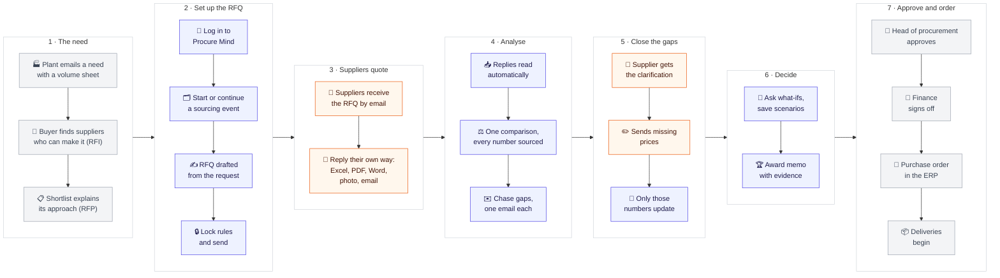
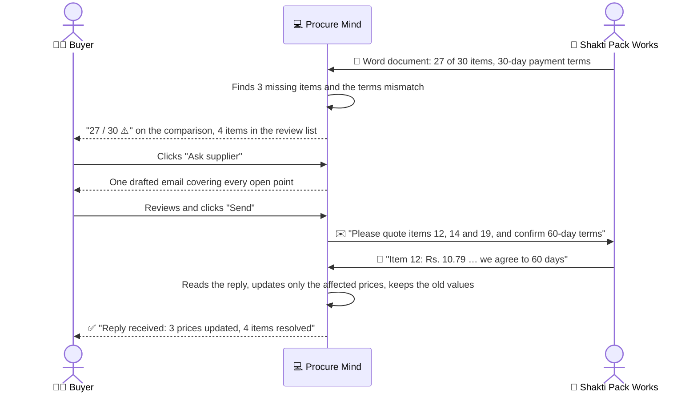

# 2 · User journeys

> **In one paragraph.** A sourcing event is a relay between the buyer, the plant that needs the goods, the suppliers, and the leaders who approve the spend. Much of it happens outside any software: emails, phone calls, approvals in meetings. This document follows the category buyer through the whole relay. It shows where Procure Mind takes over, what it does at each step, and how it hands back to the outside world.

🎨 **Visual version:** the same journey as an illustrated map is in Claude Design (link to be added when shared).

---

## 1. The whole lifecycle at a glance

**How to read it:** seven phases, left to right. 🟦 **Indigo** steps happen inside Procure Mind. ⬜ **Grey** steps happen outside it, in emails and meetings within the company. 🟧 **Orange** steps are the suppliers, who never log in and simply use email. Procure Mind's job is to make each hand-off between these worlds take minutes instead of days, and to make sure nothing is lost on the way.

## 2. The main journey: Pavan, category buyer, from request to award

**Goal:** a defensible award without retyping a single number.
**Starts when:** Plant Operations emails *"We need new shipper boxes and inner packaging for both plants, starting next quarter"*, with a volume sheet attached.

| # | Stage | Where | What Pavan does | What Procure Mind does | What used to happen |
|---|---|---|---|---|---|
| 1 | 📧 The need arrives | Outside | Reads the plant's email and volume sheet | — | — |
| 2 | 🔎 Find and shortlist suppliers | Outside | Asks a dozen box makers about capacity and certificates; shortlists five | Keeps the shortlist and the reasons, for later context | Notes scattered across emails |
| 3 | 🔐 Log in | **Inside** | Opens Procure Mind and signs in | Shows every sourcing event and its stage, plus requests waiting to be started | — |
| 4 | 🗂️ Choose the work | **Inside** | Clicks **Start RFx** on the plant's request, or **Continue** on an event already running | Opens the event at exactly the step it was left | Hunting for the latest spreadsheet version |
| 5 | ✍️ Draft the RFQ | **Inside** | Clicks **Draft RFQ**; corrects one quantity | Drafts items, quantities per plant, questionnaire, terms and cover email; checks every quantity against the volume sheet | Half a day copying specs into a template |
| 6 | 🔒 Fix the rules, then send | **Inside** | Ticks the must-have certificates, sets the pass score, clicks **Lock rules & send** | Freezes the rules with a timestamp; sends the RFQ to the five suppliers | Rules decided after prices were seen |
| 7 | 📨 Suppliers reply | Outside | Waits; answers supplier phone calls | — | — |
| 8 | 📥 Replies are read | **Inside** | Watches the replies tab (or does other work) | Reads each reply in under a minute, all in parallel, showing progress in plain words | Two to three days of retyping |
| 9 | ⚖️ Compare | **Inside** | Opens the comparison | Converts every price to one basis, highlights the cheapest valid price per item, shows questionnaire and certificate results | Formulas built by hand, errors found late |
| 10 | 🔍 Check the evidence | **Inside** | Clicks a price that came from a phone photo | Shows the photo with the exact line outlined, and every conversion step | "Let me find that email…" |
| 11 | ✅ Clear the easy flags | **Inside** | Clicks **Accept all high-confidence** | Leaves only the items that genuinely need a decision | Every oddity checked by hand |
| 12 | ✉️ Chase a gap | **Inside** | Clicks **Ask supplier** on the supplier who skipped three items; reviews the email; clicks **Send** | Drafts one specific email covering every open point for that supplier | A chaser email written from scratch, days later |
| 13 | 📨 Supplier answers | Outside | — | — | — |
| 14 | 🔄 The loop closes | **Inside** | Sees "Reply received" | Reads the answer and updates only the three missing prices; old values stay in history | Another round of retyping |
| 15 | 💬 Ask what-ifs | **Inside** | Clicks *"What if we combine both plants' volumes?"*; asks a follow-up; saves the answer as a scenario | Turns the question into an exact calculation, computes it in code, explains it in two sentences, shows the working | A new spreadsheet version for each question |
| 16 | 🏆 Recommend the award | **Inside** | Clicks **Recommend award**, then **Download PDF** | Builds the memo: award per supplier, savings, rules used, risks, and a link to the evidence for every figure | A slide deck assembled by hand |
| 17 | 👔 Approval | Outside | Presents the memo to the head of procurement and finance | Every figure can be clicked during the meeting | "I'll get back to you on that number" |
| 18 | 🧾 Purchase order | Outside | Raises the purchase orders in the ERP | The memo is the hand-off document | — |

## 3. Journey: closing the loop with a supplier

**Goal:** get missing information without writing an email by hand.

If anything is still open after the reply, the next email lists only what remains.

## 4. Journey: the leadership review

**Goal:** answer the head of procurement's questions live, and give finance proof behind every number.

1. 👔 *"Split the award: cheapest per item, but only suppliers who passed the quality questionnaire?"* The buyer clicks that suggested question.
2. 💻 Procure Mind applies the rules locked before the prices were seen, picks the cheapest eligible supplier per item, computes the totals in code, and shows the working.
3. 👔 *"And if we combine both plants' volumes?"* The buyer asks the follow-up.
4. 💻 Volume-tier prices apply; the answer shows how much it saves compared with the previous answer.
5. 🧑‍💼 The buyer saves it as a scenario and clicks **Recommend award**.
6. 💼 Finance opens the memo and clicks a ₹ figure: the supplier's own document appears, with the number outlined.
7. ✅ Approval happens outside the product, in the usual meeting. An approval workflow inside the product is on the roadmap.

## 5. Journey: a first-time visitor

**Goal:** someone who has never seen the product understands it and tries it, alone, in about ten minutes.

| # | They… | They see | Why it works |
|---|---|---|---|
| 1 | Open the link | A sign-in card over a packaging scene | Nothing to read before starting |
| 2 | Create an account | Their own workspace in a few seconds | No verification step, no setup form |
| 3 | Look around | Four sourcing events at different stages, with live numbers | Never an empty screen |
| 4 | Click **Continue** on the event being analysed | Its overview: where it stands and the next sensible step | Every screen says where you are and what to do next |
| 5 | Explore | Comparison, evidence, review, what-ifs, memo | Suggested questions; no typing needed |
| 6 | Try their own file | Upload any quote on the Replies tab | Proof that it isn't hard-coded |
| 7 | Start over | **Restore sample workspace** in the account menu | Safe to experiment |

## 6. When things go wrong

Every problem shows a plain reason and one next step.

| Situation | What the buyer sees | Next step |
|---|---|---|
| A reply can't be read (blurry photo, unusual file) | That reply shows a reason; the others carry on | Retry, upload a clearer file, or ask the supplier |
| The AI is unavailable while drafting | A prepared draft, clearly labelled | Edit and send as usual |
| A value the AI is unsure about | An amber cell and an entry in the review list, beside its source | Accept, edit, or ask the supplier |
| An item that is new this year, but the supplier said "same as last year" | "No history for this line", kept out of totals | Added to that supplier's clarification email |
| "Freight extra" with no amount | A labelled estimate the buyer can change | Set the estimate, or ask the supplier |
| A question that could mean two things | One short question back, with clickable choices | Click a choice |
| A file that's too large or not a quote | A plain message with the limits | Upload another file |
| A wrong manual edit | The change in the recent-changes list | Undo |
| The buyer closes the browser and returns tomorrow | The same event, at the same step | Carry on |
