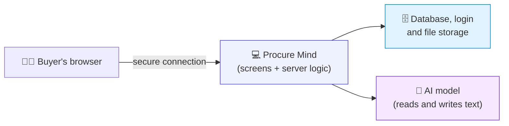
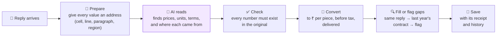

# 3 · How it is built

> **In one paragraph.** Procure Mind is a web application. The screens and the server logic are one codebase; a managed service provides the database, the login and file storage; an AI model reads documents and writes text. The design rests on one idea: **the AI reads and writes, ordinary code calculates.** The AI turns a messy document into structured data, and its output is checked. Every conversion, total and saving is then computed by plain, tested code, and every number keeps a link to where it came from.

**Section 1 is for everyone. Sections 2 onwards are for engineers.**

---

## 1. The short version, for non-engineers

### What runs where

- The **browser** only ever talks to Procure Mind; it never talks to the AI directly. The AI key stays on the server.
- The **database** enforces privacy itself: even if the application had a bug, one user could not see another user's data.
- **Original supplier files are kept unchanged**, so any number can be traced back to them.

### How a messy reply becomes a trustworthy number

Purple is the only step where AI is involved. Everything else is ordinary code that behaves the same way every time.

### How a what-if question is answered

1. 🤖 The AI works out what is being asked: *"cheapest per item, only suppliers who passed, both plants combined"*. It picks a calculation; it does not do the maths. If the question could mean two things, it asks one short question back instead of guessing.
2. 🧮 Code runs that calculation exactly on the stored numbers.
3. 🤖 The AI writes two or three sentences explaining the result.
4. ✅ Code checks every number in those sentences against the calculation. If any number doesn't match, the sentences are replaced with a plain summary written by code.
5. 💬 The buyer sees the answer, the table, and **Show working**.

### Why this matters
- **No invented numbers:** the AI can't put a figure on screen that isn't in the source document or the calculation.
- **Repeatable:** the same inputs always give the same totals.
- **Auditable:** every figure carries its source and its history.

---

## 2. Technology choices

| Layer | Choice | Why |
|---|---|---|
| Application | **Next.js 16** (React, TypeScript) | Screens and server logic in one codebase; streaming for live drafting |
| Styling | **Tailwind CSS** | A consistent, minimal design system, quickly |
| Hosting | **Vercel** (planned) | Secure public address; redeploys automatically from GitHub |
| Login | **Supabase Auth** | Email and password; passwords are never stored by the application |
| Database | **Supabase Postgres** with **row-level security** | Privacy enforced by the database, not just by application code |
| Files | **Supabase Storage** | Original supplier files kept unchanged; uploads go straight from the browser (up to 10 MB) |
| AI | **OpenAI API** (`gpt-5.5`; the model name is one setting) | Reads PDFs and images; structured output; tool calling |
| Document reading | exceljs, mammoth, pdf.js | Turn files into data where every value has an exact address |
| Validation | **zod** | AI output must match an exact shape or it is rejected |
| Testing | **Vitest**, **Playwright** | Calculation engine, database security, live AI accuracy, and full browser journeys |

**Alternatives considered:** a Python server with hand-built pages (slower to reach a polished interface), and a Python dashboard tool (couldn't deliver side drawers, inline editing or live progress). Python is still used, for the sample-data generator, where its document libraries are the strongest.

## 3. The reading pipeline in detail

Each reply runs through these steps as its own job. All replies run in parallel.

| Step | Who | Detail |
|---|---|---|
| 1. Store | Code | The original file is saved unchanged and linked to the supplier |
| 2. Prepare | Code | Excel → a grid where each value carries its cell address · Word → numbered paragraphs · PDF → pages with text positions · photo → image · email → text |
| 3. Extract | **AI** | Given the prepared reply **and** the buyer's item list, the AI returns structured data: per item, price, unit, currency, tax, tiers, discount; per supplier, terms and questionnaire answers. Each value carries its location and a confidence level |
| 4. Validate | Code | Shape check; **every number must appear in the source**; low confidence is flagged; text that looks like instructions to the AI is flagged |
| 5. Convert | Code | Per bundle / per 1,000 / per kg → per piece (kg uses box weight estimated from the specification, labelled *estimate*); USD → ₹ at the locked rate; tax removed; freight added; the volume tier matching each plant's quantity. Each step is recorded and shown to the buyer |
| 6. Resolve gaps | Code | Same reply → last year's contract (only if the specification matches) → otherwise flagged and added to the supplier's open items |
| 7. Save | Code | Value, conversion steps, source location and history. A newer reply replaces a value but never deletes the old one |

**Locating the evidence**

| Source | How the number is highlighted | Precision |
|---|---|---|
| Email | The phrase in the text | Exact |
| Excel | The cell | Exact |
| Word | The paragraph and phrase | Exact |
| PDF | The text position on the page | Exact |
| Photo | A region returned by the AI | Approximate, and labelled as such when confidence is low |

## 4. The question engine in detail

The AI has four tools and must use them; it never computes:

| Tool | Used for |
|---|---|
| `run_scenario` | Award splits, supplier filters (passed questionnaire, exclusions), combining plant volumes, "what if supplier X matches the lowest price" |
| `list_open_issues` | "Which suppliers still have open issues?" |
| `vendor_profile` | One supplier's terms, questionnaire result, certificates and items quoted |
| `ask_clarifying_question` | When a question could mean more than one thing: one short question back, with clickable choices |

The scenario specification is validated (only real suppliers, items and rules), executed by the scenario engine, explained by the AI, and number-checked before display. The award memo follows the same rule: code assembles every figure; the AI writes only the connecting sentences.

## 5. Data model

Every table carries the owner's ID, and row-level security policies make each row visible only to its owner.

| Table | Holds |
|---|---|
| `rfx` | A sourcing event: stage, the plant's request, locked rules, exchange rate, assumptions |
| `line_items` | The items being bought, with specifications and quantity per plant |
| `questions` | The quality questionnaire and which answers are required |
| `vendors` | Suppliers on the event: status, terms, summary |
| `messages`, `attachments` | Every email in and out, and its files |
| `processing_runs` | Live progress of each reading job |
| `quote_values` | **The heart of the system:** one price per supplier per item, with raw value, provenance (supplier / contract / clarification / manual), exact source location, confidence, and current-or-replaced status |
| `issues` | Everything to look at or chase: missing item, unclear term, unreadable region, no history |
| `answers`, `certificates` | Questionnaire answers and certificate validity |
| `contracts`, `contract_lines` | Last year's contracts ("memory") |
| `scenarios`, `chat_messages`, `award_memos` | Saved what-ifs, the conversation, and the memo |
| `change_log` | Every manual change, for audit and undo |
| `workspace_seeds` | Marks that a user's sample workspace has been fully created |

## 6. Design decisions

| Decision | Reason |
|---|---|
| The AI returns structured data, never free text, when reading | Every value can be validated, located and converted by code |
| Every extracted number must appear in its source | The main defence against invented numbers |
| Values are replaced, never deleted | History, undo and an audit trail for free |
| All AI calls go through one module (`src/lib/ai/`) | Changing AI provider is a one-file change |
| Email is simulated inside the product | Real email adds risk without changing the product's logic; the data model already supports it |
| Each user gets their own sample workspace; every write is checked, and a failed set-up starts again cleanly | No half-built screens, and two people never see each other's changes |
| Limits per account: 30 uploads, 80 questions a day, 10 MB per file | Protects the AI budget on a public link |
| Supplier content is data, never instructions | Protects against documents that try to manipulate the AI |

## 7. Quality

| Check | What it proves | How to run |
|---|---|---|
| Calculation engine tests | Every conversion and scenario matches a hand-checked answer key (300 of 300 prices) | `npm test` |
| Database tests | A new workspace is complete, and one account can never read or change another's data | `npm test` |
| Live AI accuracy | The AI reads the sample replies correctly (129 of 129 prices) | `bash scripts/eval-all.sh` |
| Browser journey | A first-time user can sign up and go from workspace to award memo, including live AI steps | `bash scripts/e2e.sh` |
| Type and lint checks | No type errors or code-quality warnings | `npm run typecheck && npx eslint .` |

## 8. Cost

A full run (draft one RFQ, read five replies and two clarifications, ask about ten questions, write one memo) is about thirty AI calls: a few US dollars at current model prices. A monthly spending limit is set on the AI key.

## 9. Code map

| Path | Contents |
|---|---|
| `src/app/` | Screens and server endpoints. `page.tsx` is sign-in; `rfx/` is the workspace; `rfx/[id]/` holds one sourcing event's tabs |
| `src/components/` | Shared interface pieces: evidence drawer, PDF viewer, clarification email, top bar |
| `src/lib/ai/` | The only code that talks to the AI provider |
| `src/lib/extract/` | Preparing files and AI extraction; the missing-value policy |
| `src/lib/engine/` | Pure calculation: conversion, comparison, questionnaire scoring, scenarios |
| `src/lib/pipeline/` | Reading a reply end to end |
| `src/lib/ask/` | The question engine and the number check |
| `src/lib/copilot/` | RFQ drafting |
| `src/lib/workspace/` | Creating a new user's sample workspace |
| `database/migrations/` | Tables, security policies and database functions |
| `sample-data/` | The fictional company, suppliers and reply files |
