# 4 · Screens

> **In one paragraph.** Procure Mind has one home (the workspace of sourcing events) and, inside each event, six tabs that follow the work in order: Overview, RFQ, Replies, Comparison, Review, Award. The design is calm and minimal, with one strong colour reserved for the next action, so the eye always lands on what to do next. Every screenshot below is the live product running on the sample data.

---

## Design language

| Choice | Why |
|---|---|
| **Quiet greys, one indigo accent** | The accent marks the single most useful next action on each screen; everything else stays out of the way |
| **Soft tints that always come with words** | Green = cheapest valid, amber = needs a look, red = missing or failing, blue = from last year's contract, violet = estimate, teal = updated by the supplier's clarification. Every colour has a label, and a legend is always visible |
| **Side drawers and pop-ups instead of new pages** | Checking a source or writing to a supplier never loses your place |
| **The assistant beside the numbers** | Answers and the table they refer to are visible together |
| **Stage pills on every event** | Request → RFQ → Replies → Analysis → Award: you always know where you are |
| **Desktop first** | It's a desk tool for detailed comparison work |

## Navigation

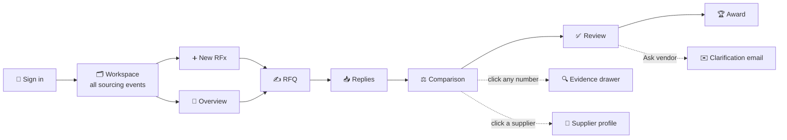

## The screens

### Sign in
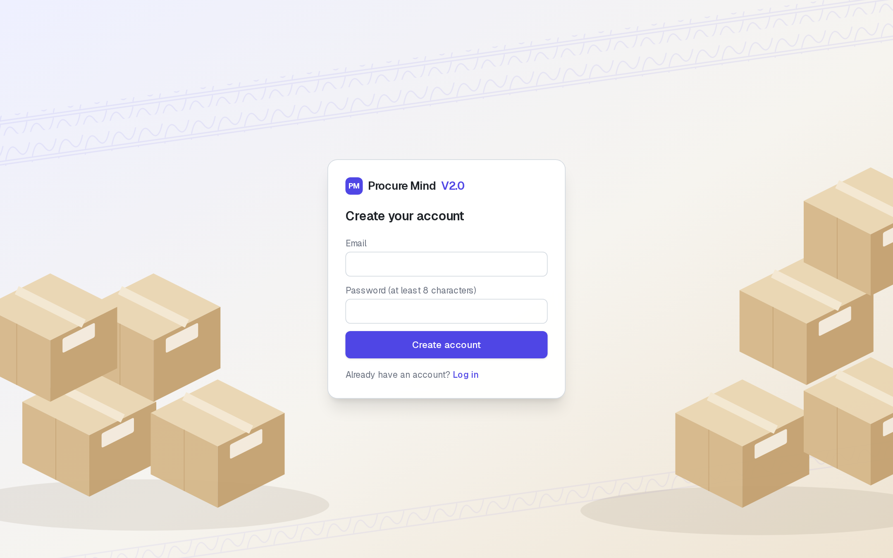
Nothing but the essentials, over a packaging scene. New accounts are ready in a few seconds.

### Workspace: every sourcing event at a glance
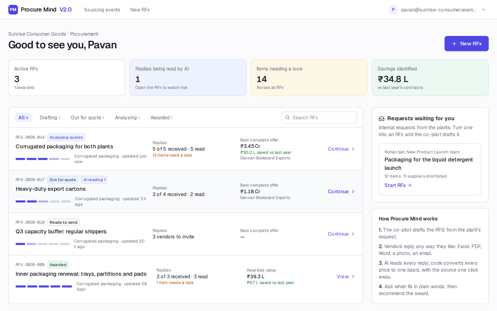
- Four headline numbers: active events, replies being read, items needing a look, savings found.
- Every event with its stage, progress, replies, best complete offer and savings. **Continue** opens it at the step where it was left.
- **Requests waiting for you**: plant requests ready to become a sourcing event in one click.

### Overview

Where this event stands, in one sentence, with the next sensible action. Below it: suppliers at a glance, the plant's original request, the shortlist, and a dated activity log.

### RFQ: drafted by the co-pilot, rules locked before prices
| Drafting live | Ready to send |
|---|---|
| 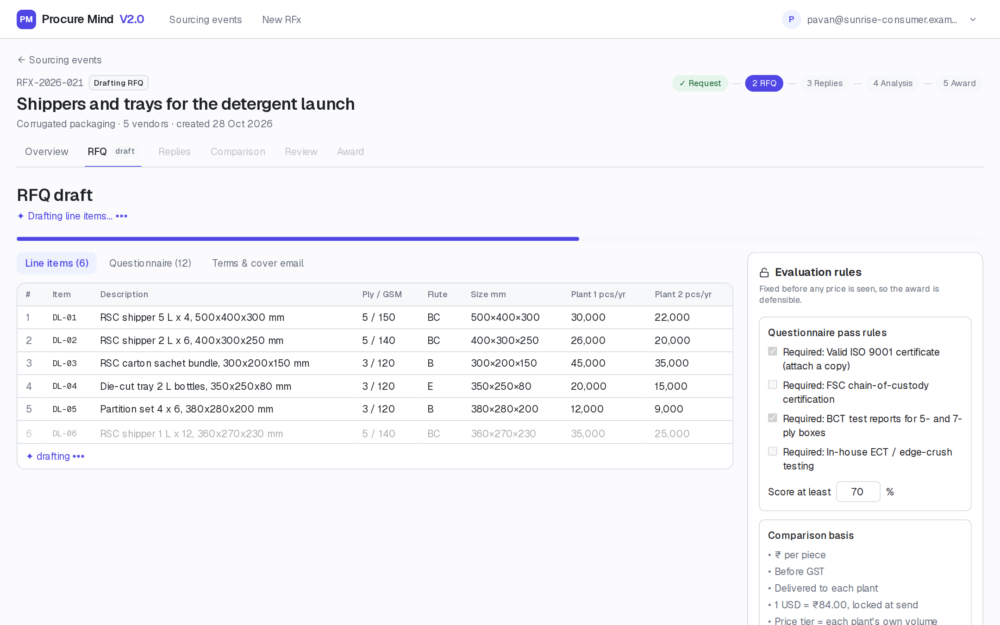 | 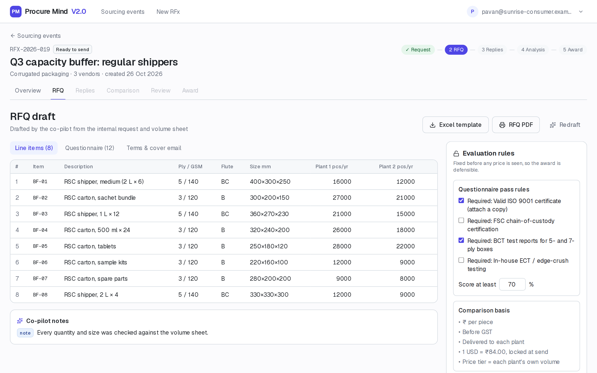 |

The co-pilot streams the items in as it writes them. On the right, the evaluation rules: required certificates, pass score and comparison basis. These are locked when the RFQ is sent, before any price is seen.

### Replies: read automatically, in parallel
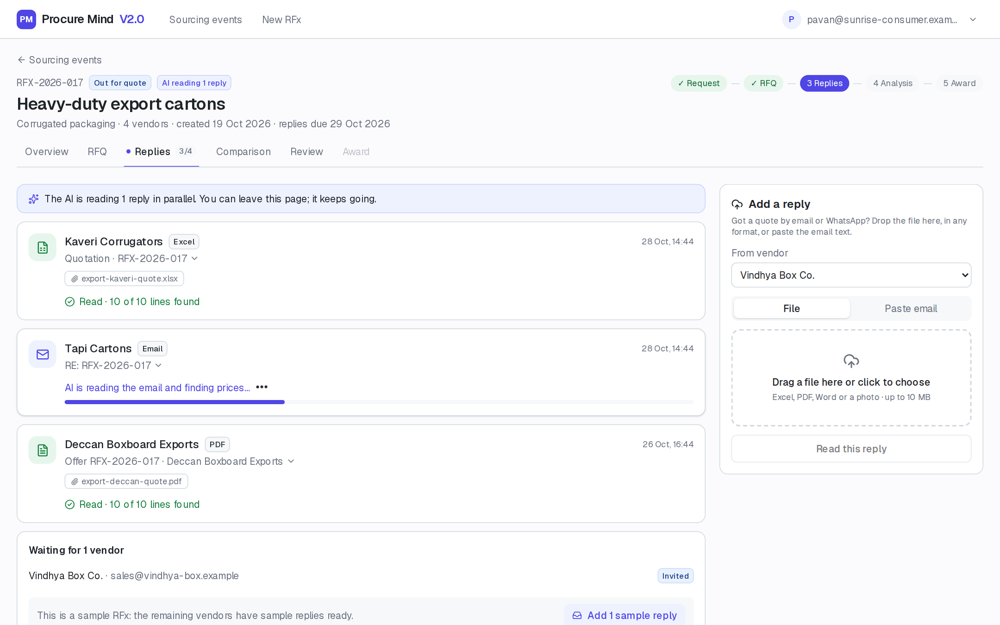
Each reply shows its format, its files and plain-language progress. The buyer can upload any reply or paste an email.

### Comparison: one basis, every number sourced
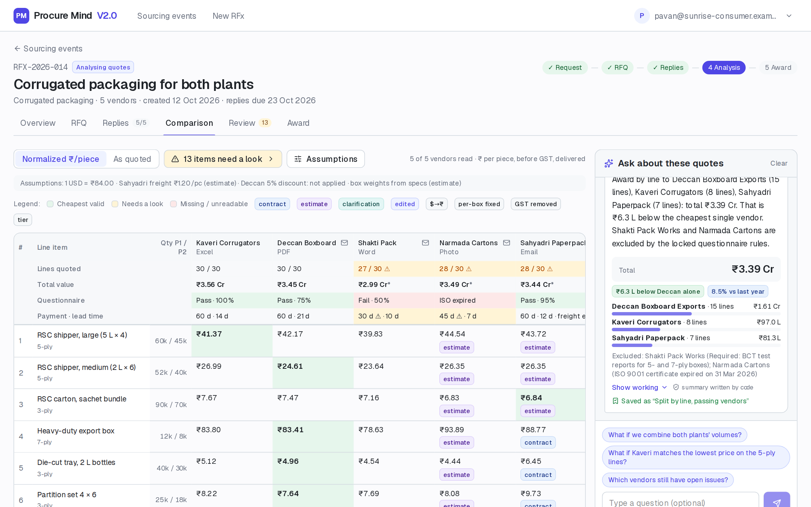
- **Converted ₹/piece** or **As quoted**, one click apart.
- A summary row per supplier: items quoted, total value, questionnaire result, payment terms and lead time.
- Badges explain every conversion: `$→₹`, `per-box fixed`, `GST removed`, `tier`, `contract`, `estimate`.
- The assistant sits on the right.

### Evidence: the supplier's own words
| From a phone photo | From a PDF |
|---|---|
| 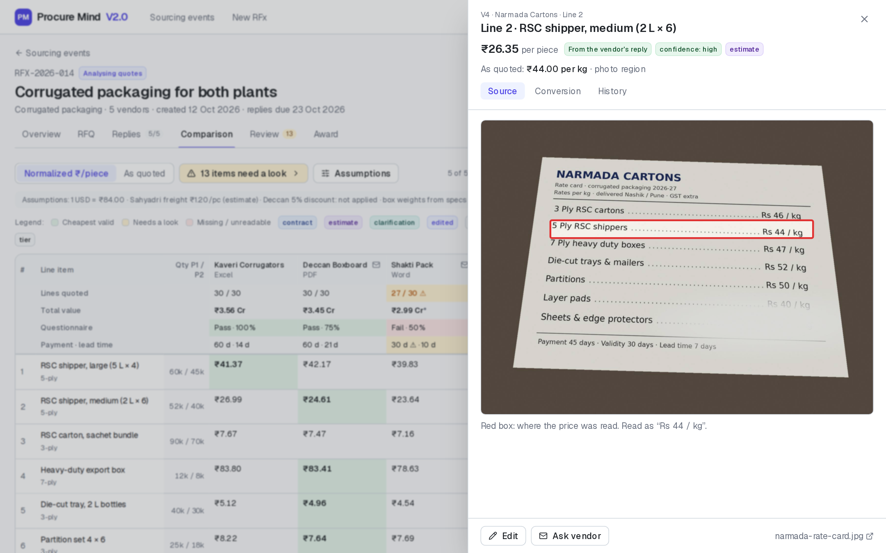 | 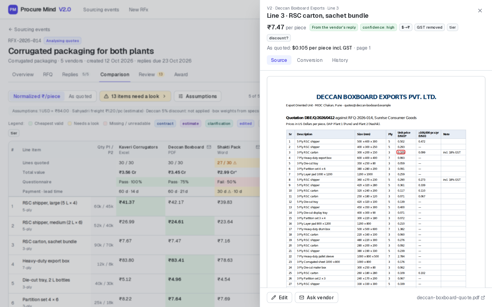 |

Click any number. The drawer shows where it came from, with the exact spot outlined, plus the conversion steps and the value's history.

### Review: everything that needs a look, in one list
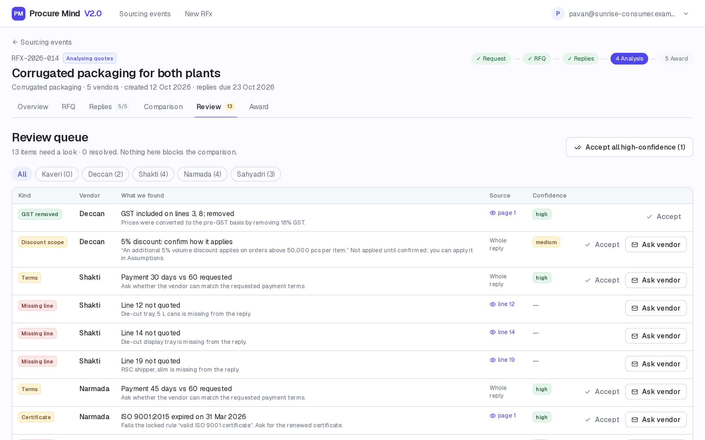
Each item sits beside its source, with **Accept**, **Edit** or **Ask vendor**. **Accept all high-confidence** clears the easy ones.

### Clarification: one email per supplier, and the loop closes
| Drafted for the buyer | Supplier answered |
|---|---|
| 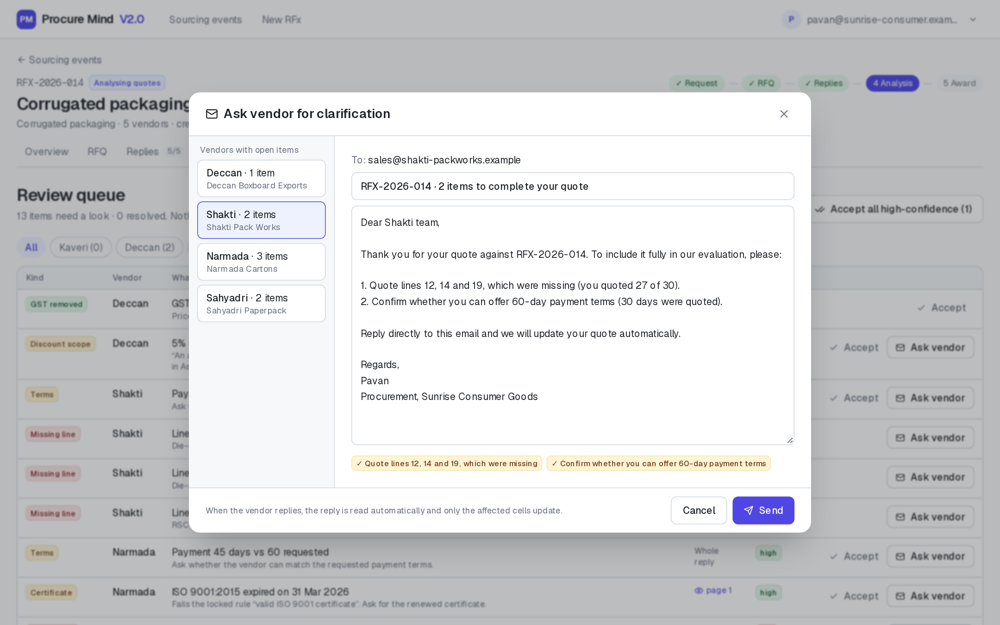 | 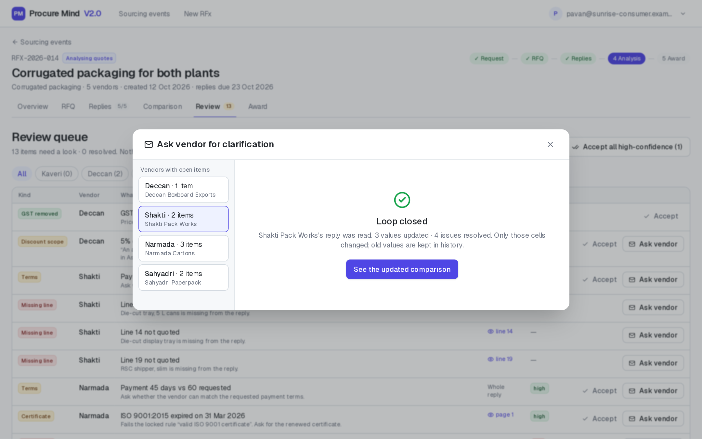 |

### Ask: what-ifs answered with the working shown
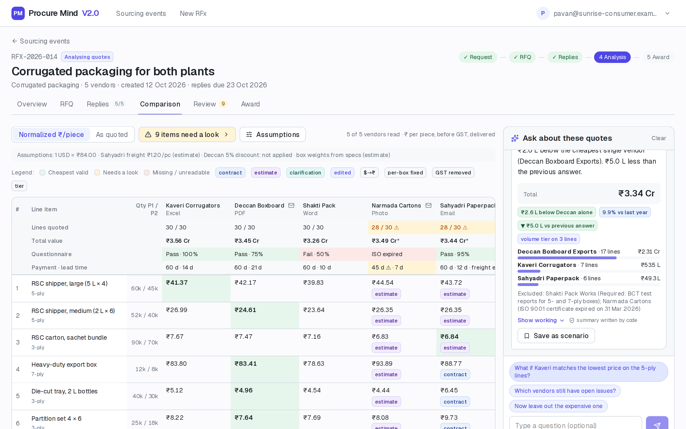
Suggested questions, follow-ups, **Show working**, and **Save as scenario**. The badges show savings against the best single supplier, against last year, and against the previous answer.

### Award memo
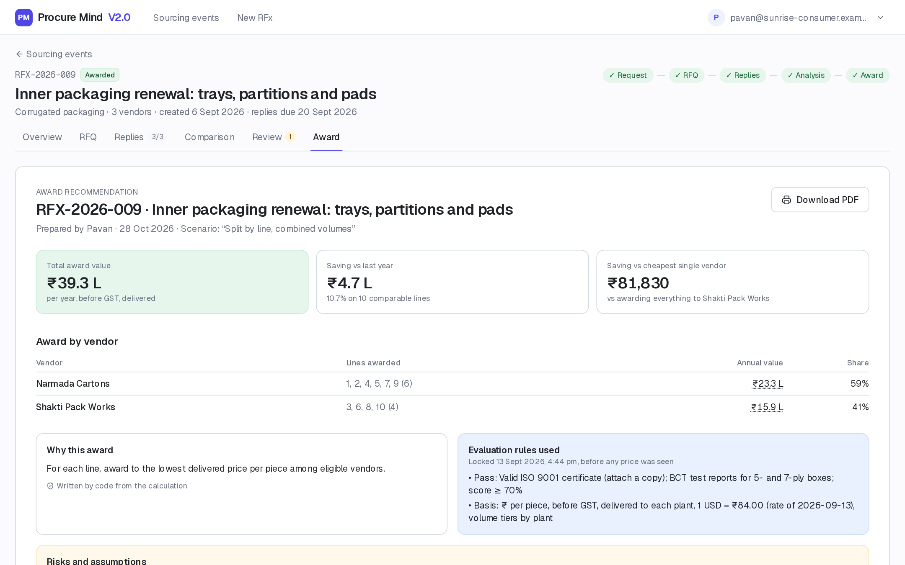
Total, savings, award per supplier, why, the rules used (with the time they were locked), risks, and every figure clickable to its evidence. **Download PDF** prints a clean copy.

### New RFx
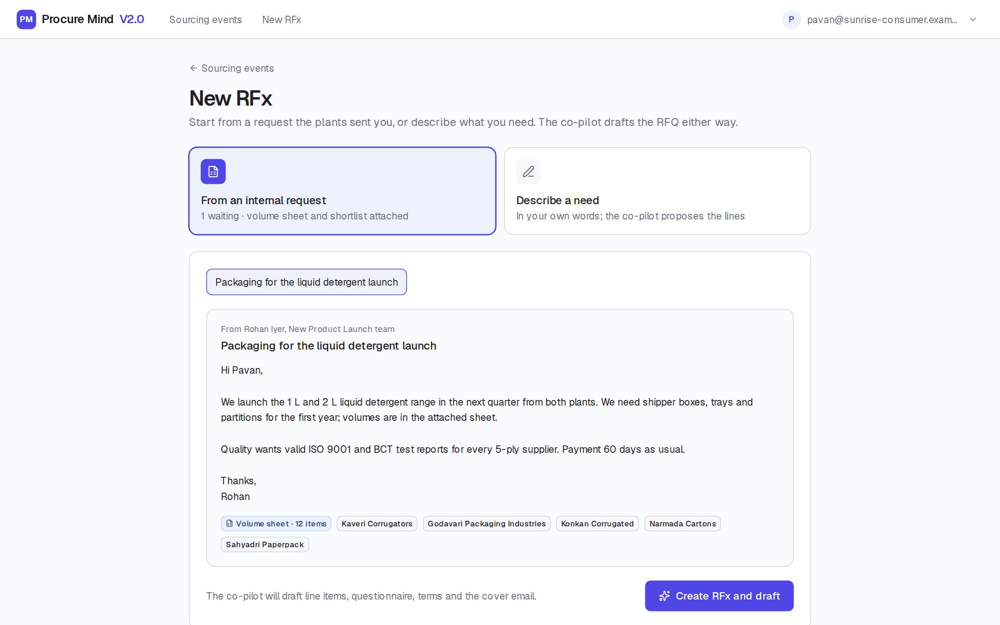
Start from a plant's request (volume sheet and shortlist attached), or describe the need in your own words. In the second case, the co-pilot flags everything it had to assume.

---

## Early sketches

Before the build, every screen was sketched as a wireframe to agree layout and behaviour. The sketches are in [`diagrams/`](diagrams/) (`wire-*.excalidraw`; open them at [excalidraw.com](https://excalidraw.com)). The built product follows them, with one deliberate change: the guided tour in the sketches was replaced by a workspace of sourcing events at different stages, so the product feels like a working tool rather than a demo.
