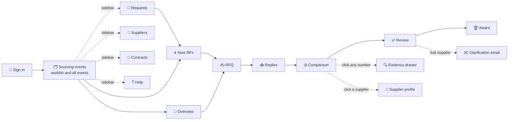

# 4 · Screens

> **In one paragraph.** Procure Mind opens on a worklist of what needs the buyer's action, above every sourcing event at whatever stage it is. A left sidebar leads to Requests, Suppliers, Contracts and Help; a top bar holds search and notifications. Inside each event, six tabs follow the work in order: Overview, RFQ, Replies, Comparison, Review, Award. The look is calm and audit-grade, with colour used only where it means something. Every screenshot below is the live product running on the sample data.

---

## Design language ("Ledger")

| Choice | Why |
|---|---|
| **Warm paper neutrals, ink type, one petrol accent** | Feels like a finance tool you would trust with a crore-rupee award. The petrol accent marks actions and the best valid price; nothing else competes with it |
| **Colour only for meaning** | Amber = needs a look, red = missing or failing. Conversions, contract prices and estimates are quiet grey tags, so the exceptions stand out |
| **IBM Plex Sans and Plex Mono** | A typeface with character for text; a monospaced face for codes and money, so figures line up in tables |
| **Short, functional wording** | Screens say what something is and what to do, not how the product works. The explanations live in Help and in these documents |
| **Side drawers and pop-ups instead of new pages** | Checking a source or writing to a supplier never loses your place |
| **The question panel beside the numbers** | Answers and the table they refer to are visible together |
| **The sidebar slims to icons inside an event** | The comparison keeps its full width |
| **Desktop first** | It's a desk tool for detailed comparison work |

## Navigation

## The screens

### Sign in

Nothing but the essentials, over a packaging scene. New accounts are ready in a few seconds.

### Sourcing events: the worklist first

- **Needs your action**: flagged items to review, replies being read, RFQs ready to send, new requests, each with one button.
- One quiet summary line: active events, replies being read, open items, savings found.
- **All events**: stage, replies, best complete offer and saving against last year, filterable by stage. Any row opens the event at the step where it was left. Sample events carry a small "Sample" tag.
- **Requests**, **Suppliers** and **Contracts** in the sidebar show the plants' waiting requests, the supplier directory with each supplier's events, and last year's contracts.

### Overview

Where this event stands, in one sentence, with the next sensible action. Below it: suppliers at a glance, the plant's original request, the shortlist, and a dated activity log.

### RFQ: drafted for you, rules locked before prices
| Drafting live | Ready to send |
|---|---|
|  |  |

The items stream in as they are drafted. On the right, the evaluation rules: required certificates, pass score and comparison basis. These are locked when the RFQ is sent, before any price is seen.

### Replies: read automatically, in parallel

Each reply shows its format, its files and plain-language progress. The buyer can upload any reply or paste an email.

### Comparison: one basis, every number sourced

- **Converted ₹/piece** or **As quoted**, one click apart.
- A summary row per supplier: items quoted, total value, questionnaire result, payment terms and lead time.
- Badges explain every conversion: `$→₹`, `per-box fixed`, `GST removed`, `tier`, `contract`, `estimate`.
- The assistant sits on the right.

### Evidence: the supplier's own words
| From a phone photo | From a PDF |
|---|---|
|  |  |

Click any number. The drawer shows where it came from, with the exact spot outlined, plus the conversion steps and the value's history.

### Review: everything that needs a look, in one list

Each item sits beside its source, with **Accept**, **Edit** or **Ask supplier**. **Accept routine items** clears the easy ones.

### Clarification: one email per supplier, and the loop closes
| Drafted for the buyer | Supplier answered |
|---|---|
|  |  |

### Ask: what-ifs answered with the working shown

Suggested questions, follow-ups, **Show working**, and **Save as scenario**. The badges show savings against the best single supplier, against last year, and against the previous answer.

### Award memo

Total, savings, award per supplier, why, the rules used (with the time they were locked), risks, and every figure clickable to its evidence. **Download PDF** prints a clean copy.

### New RFx

Start from a plant's request (volume sheet and shortlist attached), or describe the need in your own words. In the second case, everything that had to be assumed is flagged for you.

---

## Early sketches

Before the build, every screen was sketched as a wireframe to agree layout and behaviour. The sketches are in [`diagrams/`](diagrams/) (`wire-*.excalidraw`; open them at [excalidraw.com](https://excalidraw.com)). The built product follows them, with one deliberate change: the guided tour in the sketches was replaced by a workspace of sourcing events at different stages, so the product feels like a working tool rather than a demo.
