# 6 · Brand and design

> **In one paragraph.** The first working version of Procure Mind did everything it promised, but it looked and sounded like many AI-built apps: stock indigo, pastel cards, sparkle icons, and screens that kept explaining that "the AI" was at work. Before showing it to anyone, we treated that as a product problem. We explored three brand directions on the same screens, chose one ("Ledger"), and rewrote the product's voice so it simply does the work. This document records that decision and the rules that keep the product consistent.

---

## 1. The problem we set out to fix

| What made it feel generic | What we did |
|---|---|
| Default colours and components every AI-built app ships with | A deliberate palette and typeface, defined once as named tokens |
| A "PM" square for a logo, with "V2.0" in the name | A real mark and wordmark |
| Pastel colour everywhere, so nothing stood out | Colour only where it means something |
| Screens that explained the product ("the AI turns your question into a calculation…") | Short, functional wording; the explanations moved to Help and these documents |
| Labels such as "co-pilot", "AI reading", sparkle icons | No AI labels at all. The product just reads, drafts and answers |
| A demo-style home ("Good to see you", stat cards) | A worklist: what needs the buyer's action today |
| No product frame | A sidebar, search, notifications, account menu: the furniture of a real tool |

**Where we started**

| Home | Comparison | Event overview |
|---|---|---|
| 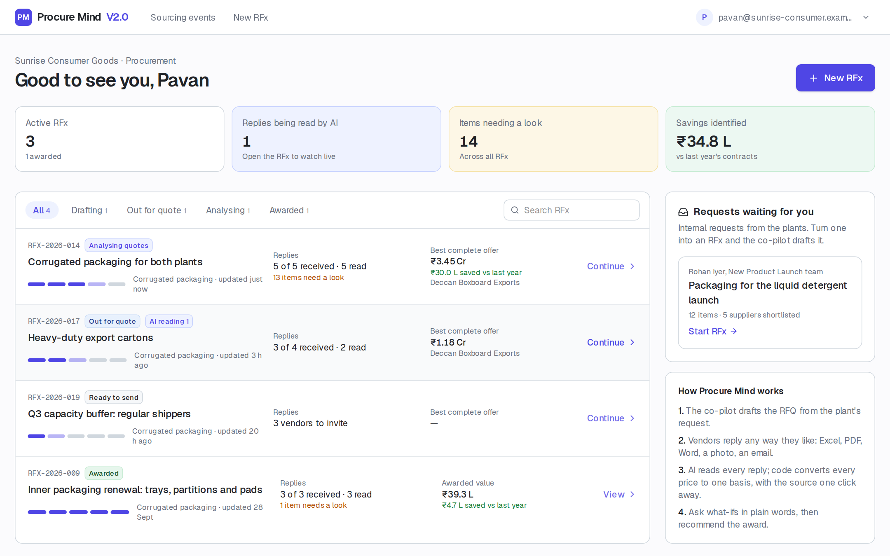 |  | 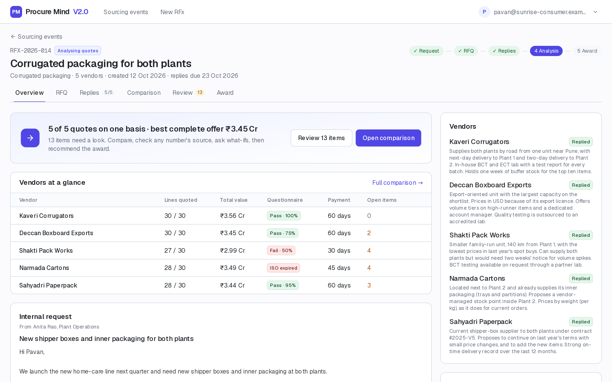 |

## 2. Three directions, same screens

Each direction was applied to the same home screen with the same data, so the choice was about look and feel only.

| | A · Ledger (chosen) | B · Slate | C · Kraft |
|---|---|---|---|
| Feel | Audit-grade calm: warm paper, ink, one petrol accent | Modern enterprise: navy frame, cobalt accent | Rooted in packaging: kraft tones, forest accent |
| Strength | Reads as a finance tool you'd trust with a crore-rupee award, matching "every number has a receipt" | Instantly familiar as enterprise software | Unmistakably about packaging, warm and memorable |
| Trade-off | Quietest at first glance | Least distinctive | Tied to one category |
| Brand card | 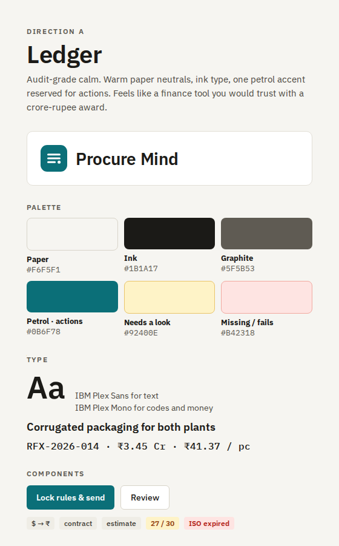 | 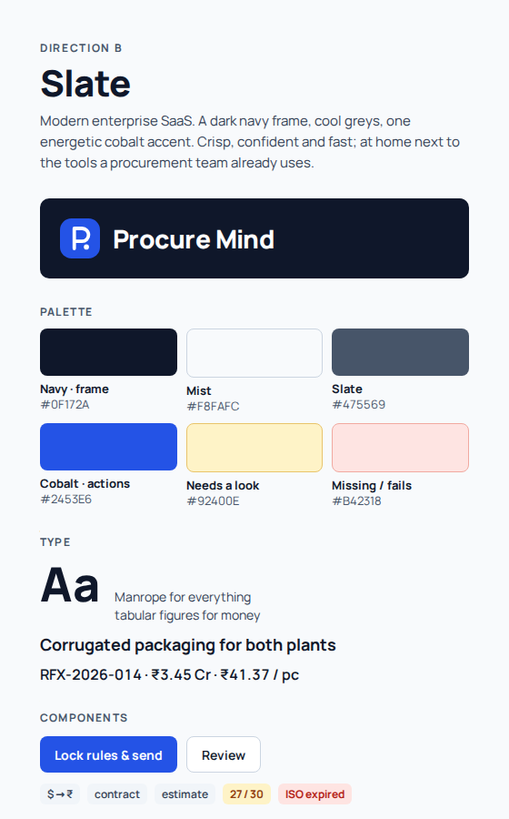 | 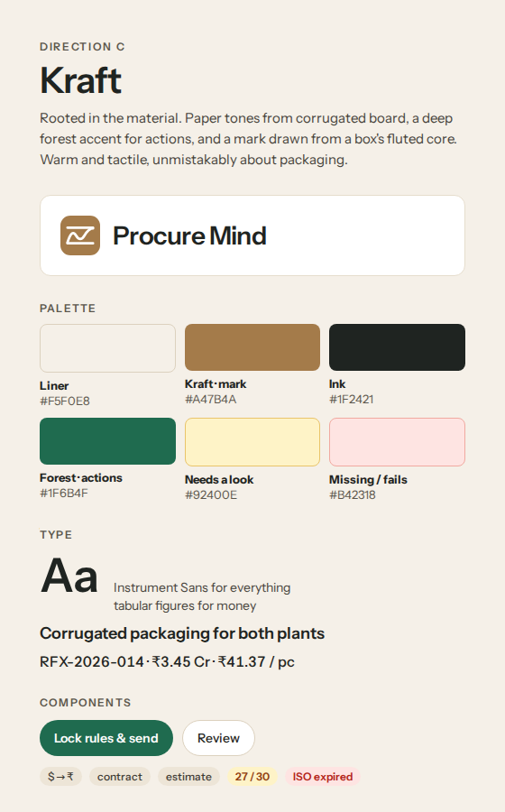 |

| A · Ledger | B · Slate | C · Kraft |
|---|---|---|
| 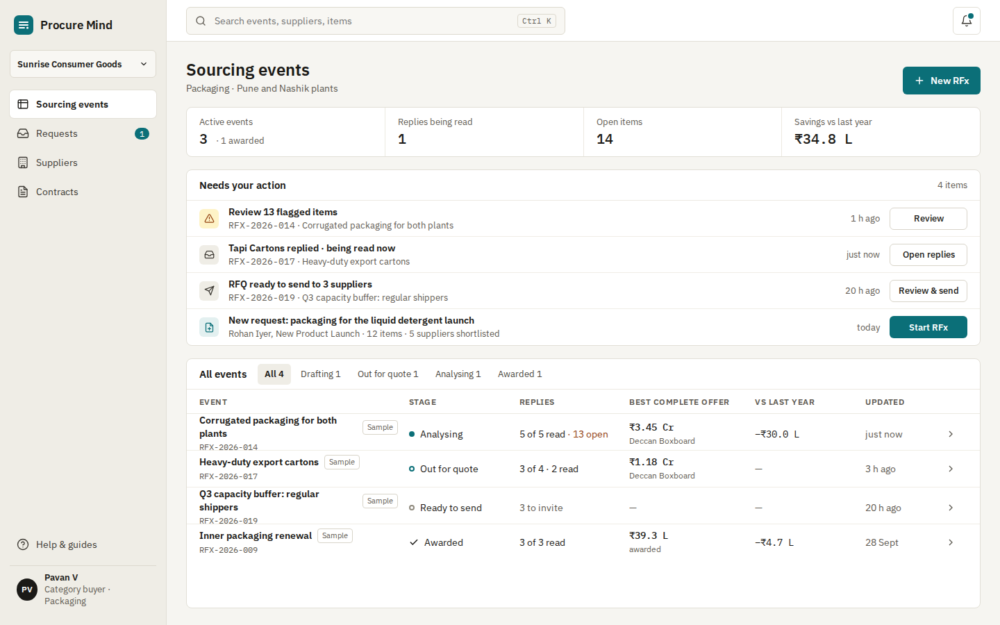 | 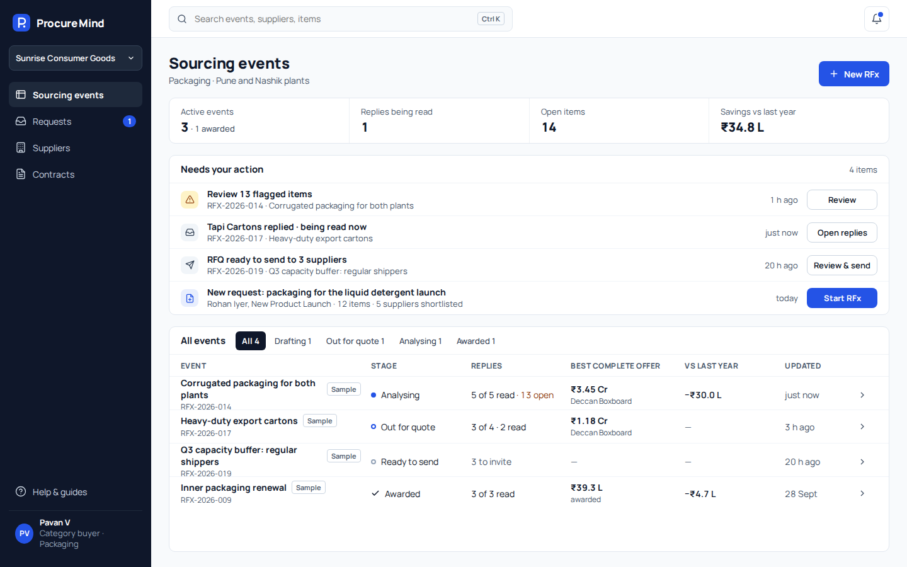 | 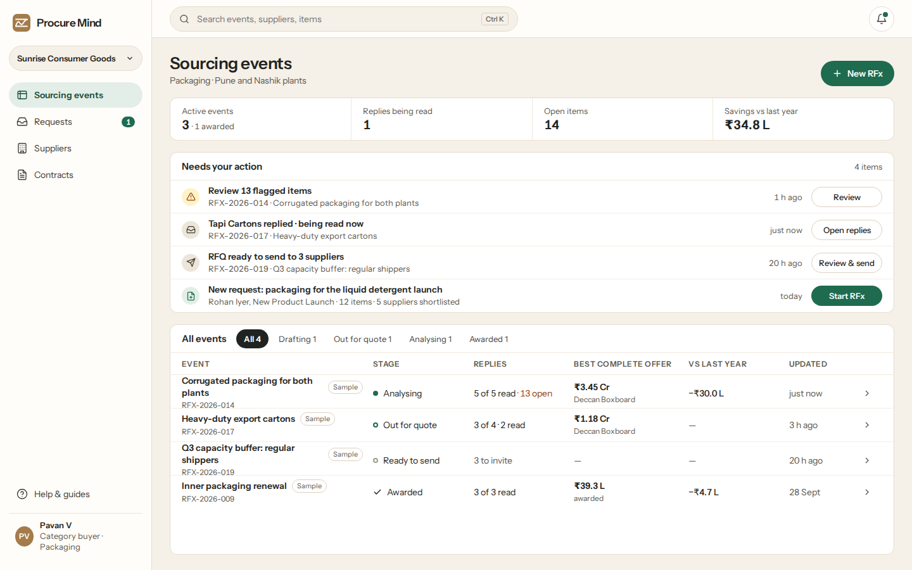 |

**Decision (2026-10-29): A · Ledger.** The product's promise is trust, so it should look like a tool finance would sign off on. The mockups of the chosen direction on the event screens:

| Comparison | Event overview |
|---|---|
| 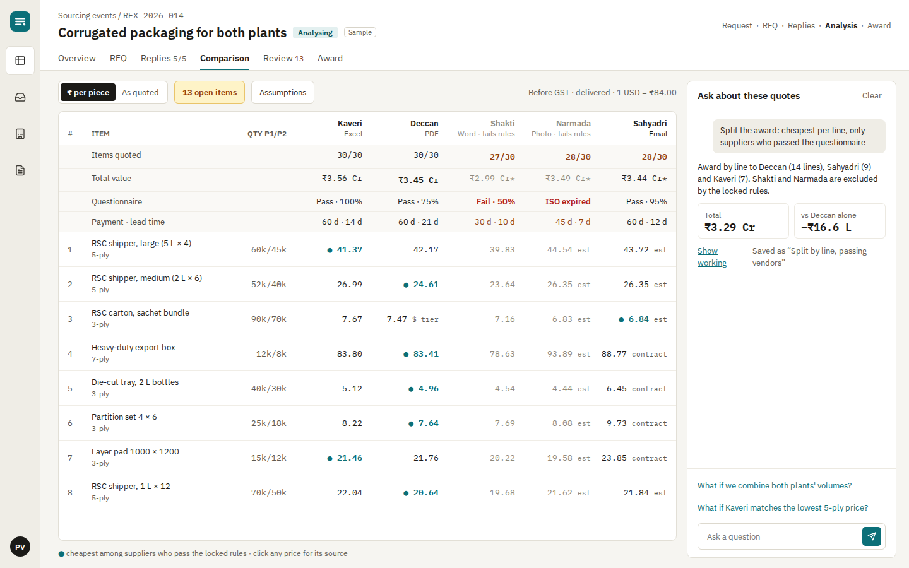 | 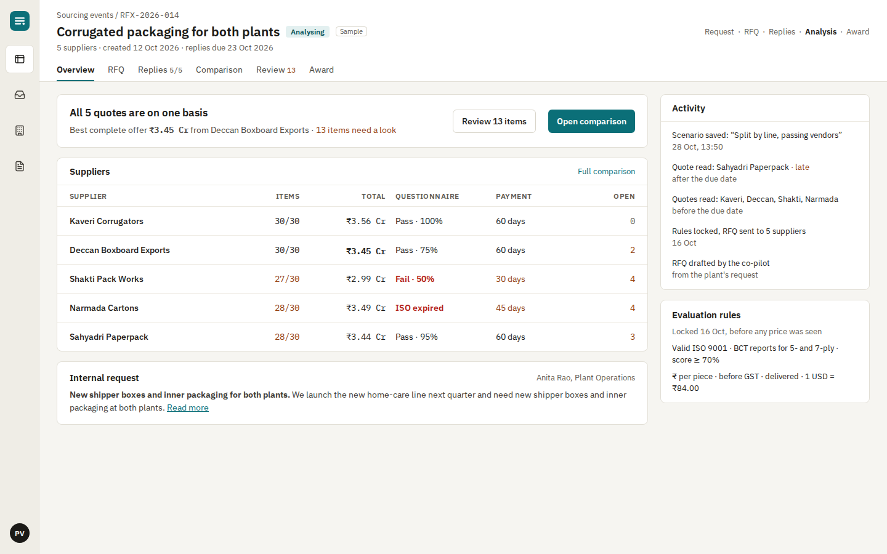 |

The built product is in [Screens](../04-screen-designs.md).

## 3. Brand guidelines

### Name and logo

- The name is **Procure Mind**: two words, no version number, no abbreviation in product text.
- The mark is a petrol square with three ruled ledger lines and a closing point: a ledger whose last line is settled. It stands for every number being accounted for.
- Files: [`logo/procure-mind-mark.svg`](logo/procure-mind-mark.svg) (petrol, the default) and [`logo/procure-mind-mark-ink.svg`](logo/procure-mind-mark-ink.svg) (ink, for single-colour use).
- The wordmark is the name in IBM Plex Sans SemiBold, beside the mark. Keep the mark at least 24 px, never rotated or recoloured outside the two versions.

 &nbsp; 

### Colour

Colour carries meaning, never decoration.

| Token | Hex | Used for |
|---|---|---|
| Paper | `#F6F5F1` | Page background |
| Surface | `#FFFFFF` | Cards, tables, panels |
| Sidebar | `#EFEDE6` | Navigation |
| Line | `#E2DFD6` | Borders and dividers |
| Ink | `#1B1A17` | Text |
| Graphite | `#5F5B53` | Secondary text (passes 4.5:1 on paper) |
| **Petrol** | `#0B6F78` | The one accent: primary actions, the active tab, the best valid price |
| Amber | `#92400E` on `#FEF3C7` | Needs a look |
| Red | `#B42318` on `#FEE4E2` | Missing, unreadable or failing a rule |

Informational markers (currency converted, contract price, estimate, clarification) are **quiet grey tags**, so that exceptions stand out. All tokens live in one place in the code: [`src/app/globals.css`](../../src/app/globals.css).

### Typography

- **IBM Plex Sans** for all text: a typeface with engineering character, designed for interfaces.
- **IBM Plex Mono** for codes and money (`RFX-2026-014`, `₹3.45 Cr`), so figures line up in tables.
- Page titles 22–24 px, section titles 15 px, body 14 px, table detail 13 px.

### Voice and wording

The product speaks like an experienced colleague: brief, specific, never selling itself.

| Rule | Instead of | Write |
|---|---|---|
| No AI labels: the work just happens | "Draft RFQ with co-pilot" · "AI reading 2" | "Draft RFQ" · "Reading 2 replies" |
| Say what it is, not how it works | "The AI turns your question into a calculation; code does the math" | "Ask about prices, award splits or what-ifs. Every answer shows its working." |
| One word for one thing: **supplier** | vendor / supplier, mixed | supplier, everywhere |
| Functional, not celebratory | "Loop closed" · "Nothing to review 🎉" | "Reply received: 3 prices updated" · "No open items." |
| Plain over jargon | "Normalized ₹/piece" · "confidence: high" | "₹ per piece" · "clear read" |
| Explanations live in Help | Pitch copy inside screens | One sentence on the Help page; the full story in these docs |

The one place the product says how numbers are produced is the Help page: *a language model reads each supplier's documents; every number it reports must appear in the original; all calculations are done by fixed rules; anything unclear is flagged, never assumed.*

### Components and layout

- **Primary button:** petrol fill, white text, at most one per area. **Secondary:** white with a thin border.
- **Tags:** small, grey by default; amber or red only for exceptions.
- **Tables:** dense, with monospaced figures; the best valid price in petrol, suppliers who fail the locked rules in grey.
- **Frame:** a sidebar (slimmed to icons inside an event), a top bar with search and notifications, and a breadcrumb and stage line on every event.
- **Accessibility:** text contrast at least 4.5:1; real buttons and links; labels on icon-only controls.

## 4. The user journey

The category buyer's journey was mapped before the redesign, inside and outside the product. The full write-up is in [User journeys](../02-user-journeys.md).

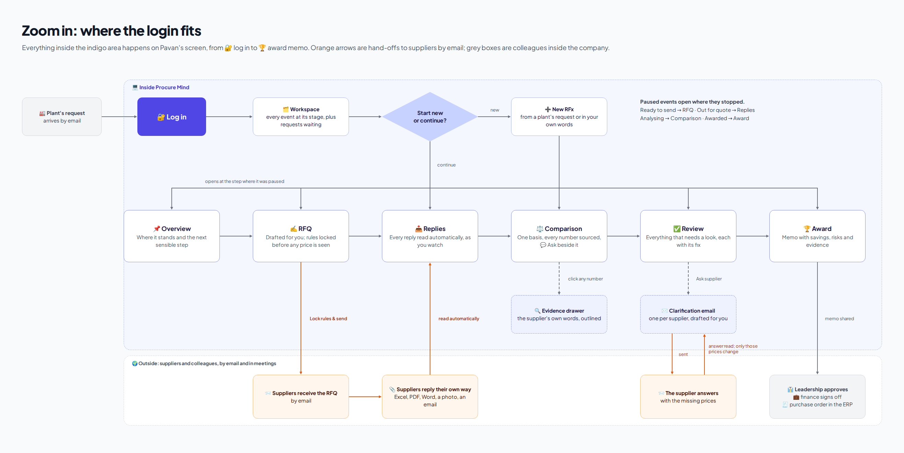

## 5. Sources

The boards above were designed in Claude Design; their source files are in [`source/`](source/). The product screenshots are regenerated from the running app with `node scripts/screenshots.mjs`.
